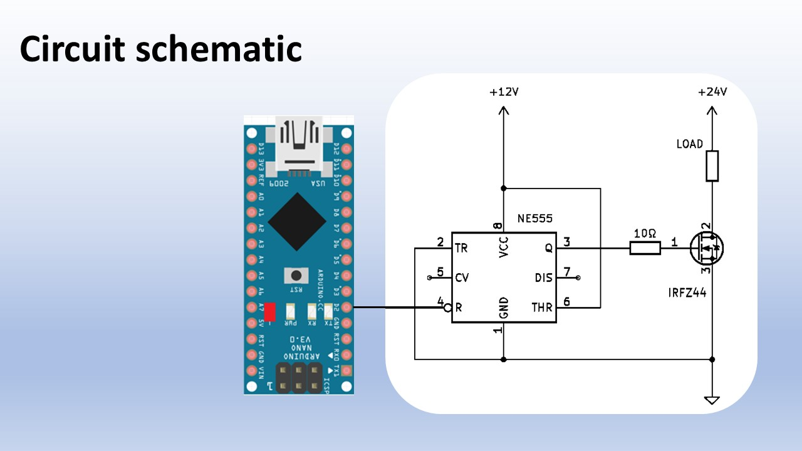
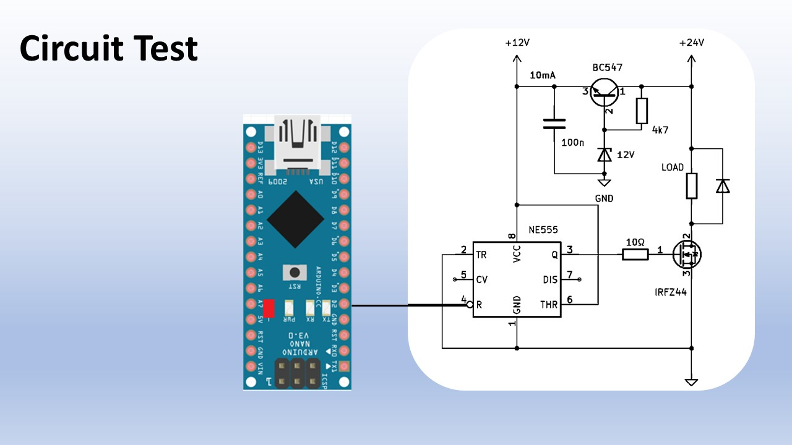
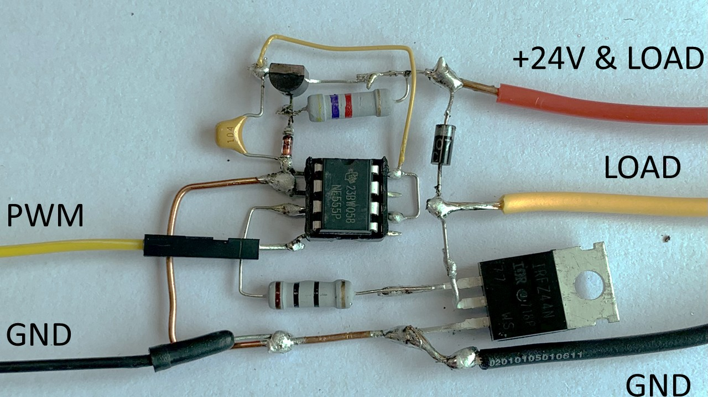

# Description

The NE555 makes a pretty decent MOSFET gate driver.
Wint only one NE555, you can convert 3.3V logic to a gate drive signal of 12V/200mA up to 500kHz, in the YouTube video I explain and demonstrate the circuit

# Check out the video:

# Schematic of the NE555 as a MOSFET Gate Driver:  
Except for a Gate resistor, no additonal parts are needed.

# Test schematic of the NE555 driving a MOSFET at 24V:   

# Prototype circuit of the NE555 driving a MOSFET at 24V:   

# Files:  
  
-Schematic file (jpg)  
-Arduino Nano PWM demo code - set PWM duty / Freqeuncy with the serial monitor. 
